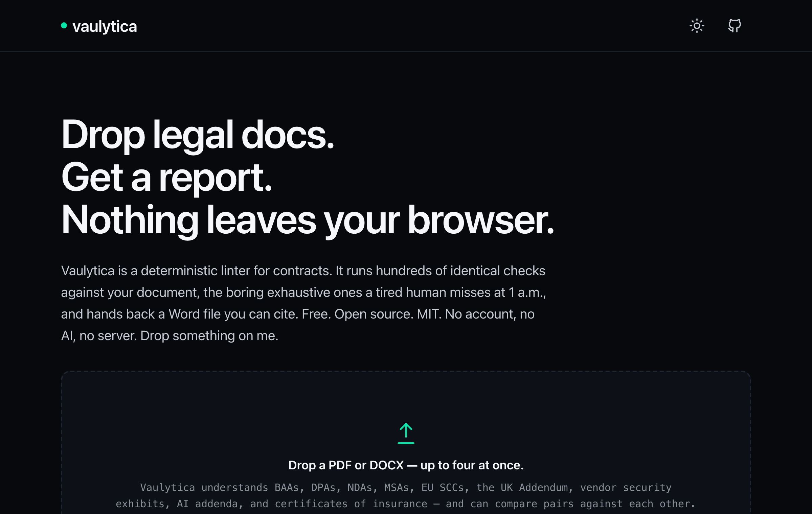

# Vaulytica

**A free contract checker that runs entirely in your browser.** Think of it as a spell-checker for legal documents.

Drop in a contract, get back a report of what looks wrong or missing. No sign-up, no upload, no AI.

👉 **Try it: [vaulytica.com](https://vaulytica.com)**



## What it does

- **Finds problems** like uncapped liability, missing signature lines, blank `[placeholders]`, broken cross-references, and risky auto-renewals.
- **Knows the document type.** An NDA, a lease, and a will each get the checks that fit them, across 260+ kinds of documents.
- **Checks a whole deal at once.** Drop a folder and it flags documents that disagree with each other, like two different governing laws.
- **Catches things before you hit send**, like leftover tracked changes, reviewer comments, and hidden text.
- **Gives you a Word report** you can share, with every finding tied to a numbered rule and, where it applies, a cited source.

## Why trust it

- **Private.** Your file never leaves your browser tab. There is no server to send it to.
- **Consistent.** The same document always gets the exact same report. There is no AI guessing.
- **Free and open source** under the MIT license.

## How to use it

1. Open [vaulytica.com](https://vaulytica.com).
2. Drag in a PDF, a Word file or a text file (or a folder or `.zip`) — or paste the text.
3. Read the results, then download the report.

## Command line

Run the same checks from a terminal (Node 22+). Reports land in the `report` folder:

```bash
git clone https://github.com/clay-good/vaulytica.git && cd vaulytica && npm install
```

```bash
npm run cli -- analyze contract.docx --format html --out report
```

Point it at a folder to get one page that says which documents need a person first:

```bash
npm run cli -- analyze ./contracts --format triage-md
```

Or one row per agreement, the table a diligence starts from: type, parties, effective date, renewal, governing law, forum and cap, each with the section it was read from (the tab offers the same file as "Contract inventory" when you drop a folder):

```bash
npm run cli -- analyze ./contracts --format inventory-csv --out reports
```

Pin your team's settings once, in a `vaulytica.config.json` at the root of the repository: the playbook, the document type for each folder, the gate, the formats. The command line, the GitHub Action and the agent server all read it, a flag you type always wins, and every run says which file it applied. `npm run cli -- init` writes an example; the [CI guide](docs/ci-integration.md#configuration-file) lists the keys.

Or add it to a GitHub workflow:

```yaml
- uses: clay-good/vaulytica@v9
  with:
    command: analyze
    files: contracts/
```

## For a coding agent

Vaulytica also runs as a local [MCP](https://modelcontextprotocol.io) server, so an agent such as Claude Code can lint a folder of contracts and hand you a short report to spot-check. It runs from the clone above, on your machine. Nothing is hosted, and nothing is on npm.

From the folder that holds your contracts:

```bash
claude mcp add --scope user vaulytica -- node ~/vaulytica/bin/vaulytica.mjs mcp
```

Any other agent host takes the same command in its own config:

```json
{
  "mcpServers": {
    "vaulytica": { "command": "node", "args": ["/path/to/vaulytica/bin/vaulytica.mjs", "mcp"] }
  }
}
```

The server reads only the folder it was started in (add `--root <dir>` for others) and opens no network connection. Keep in mind that whatever it returns goes to your agent and its model provider, including quoted excerpts; ask for `excerpts: false` to leave those out. The [reference](docs/reference.md#for-a-coding-agent--the-local-mcp-server) lists the eight tools.

## Learn more

- [Full reference](docs/reference.md): every check, command, and export format
- [CI setup](docs/ci-integration.md)
- [Contributing](CONTRIBUTING.md)

## Disclaimer

Vaulytica is a software tool, not a lawyer. It does not give legal advice. If something matters, talk to a lawyer.
